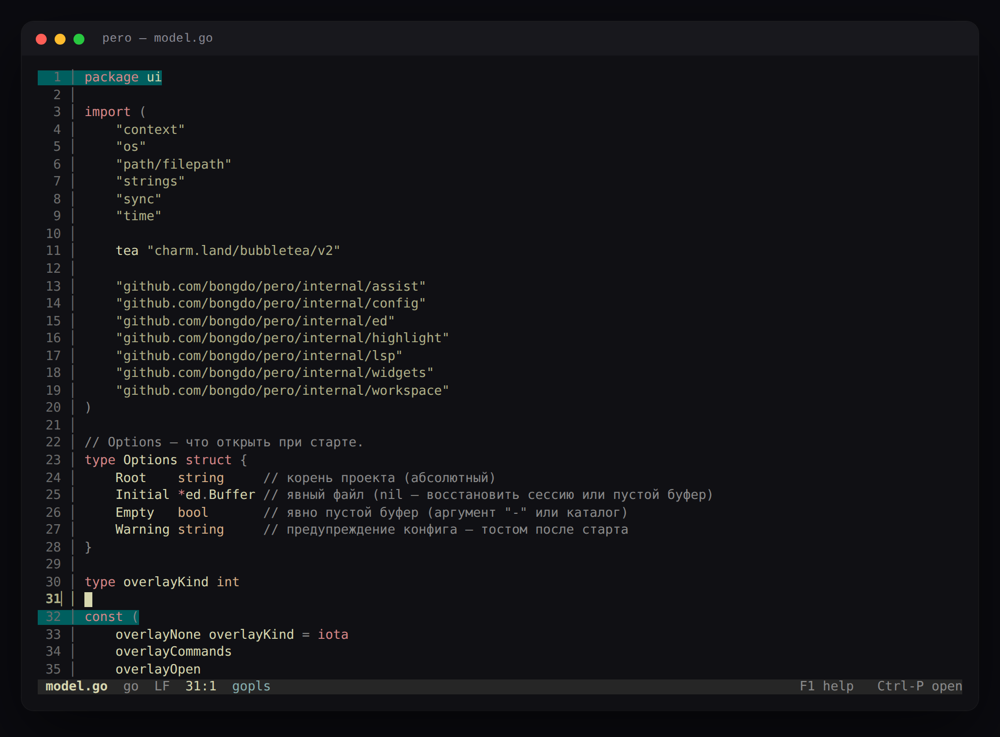

# pero

A modeless terminal code editor with tabs, mouse, LSP and ghost suggestions.
Built with [Bubble Tea v2](https://github.com/charmbracelet/bubbletea) and
[chroma](https://github.com/alecthomas/chroma).



`pero` is not a Vim clone. Letters always type text; actions live on `Ctrl`,
`Alt` and function keys. The editor is also not a minimal `$EDITOR`: it has
tabs, a fuzzy file opener, a session that survives restarts, syntax
highlighting, diagnostics and inline completion.

## Features

- **Tabs and session** — open files in tabs, restore tabs and cursor positions
  on the next launch.
- **Modeless editing** — selections with mouse or keyboard, undo/redo with
  grouped edits, autopairs, bracket wrapping, smart Backspace/Enter/Home.
- **Search and replace** — `Ctrl-F` and `Ctrl-H`, with visible matches.
- **Fuzzy open** — `Ctrl-P` searches files in the project and recent files.
- **Command palette** — `Ctrl-E` opens a filterable list of commands; the path
  mode (`Ctrl-P` inside the palette) opens files by path.
- **LSP** — diagnostics, hover, definition, references, formatting, completion,
  quickfix and signature help. Servers are configured per filetype.
- **Ghost text** — suggestions from LSP and words already in the buffer, shown
  after 250 ms; `Tab` accepts the current suggestion.
- **AI assist** — `Alt-a` sends the selection to `opencode run` and inserts the
  result after confirmation; the UI never blocks on it.
- **Themes and language** — 33 syntax themes, `theme` in the config; the UI is
  available in English and Russian (`language = "en" | "ru"`).
- **Markdown care** — checkbox toggle (`Alt-t`), list continuation, spell check
  through ltex/harper, and a softwrap mode for prose.

## Install

Requires Go 1.26+ and a truecolor terminal.

```sh
go install github.com/bongdo/pero@latest
pero
```

From a checkout:

```sh
go build -o pero .
./pero
```

Open a file, a directory, or an empty buffer:

```sh
pero                       # empty buffer in the current project
pero main.go               # file
pero ~/notes               # directory = project root
pero -                     # explicitly empty buffer
```

## Keys

| Key | Action |
|---|---|
| `Ctrl-S` / `Ctrl-Shift-S` | save / save as |
| `Ctrl-Q` | quit (asks when the buffer is dirty) |
| `Ctrl-Z` / `Ctrl-Y` | undo / redo |
| `Ctrl-F` / `Ctrl-H` | search / replace |
| `Ctrl-P` | fuzzy open |
| `Ctrl-O` | new tab |
| `Ctrl-E` | command palette |
| `Ctrl-A`, `Ctrl-C`, `Ctrl-X`, `Ctrl-V` | select all, copy, cut, paste |
| `F8` / `Shift-F8` | next / previous diagnostic |
| `Alt-.` | quickfix |
| `Alt-t` | toggle a Markdown checkbox |
| `Alt-a` | ask `opencode` about the selection |

The full key inventory and UX notes are in [`docs/00 MOC.md`](docs/00%20MOC.md).

## Configuration

`pero` creates a commented config on first run:

```
$XDG_CONFIG_HOME/pero/config.toml
~/.config/pero/config.toml
```

Session state (tabs, positions, recent files) lives separately:

```
$XDG_STATE_HOME/pero/state.toml
~/.local/state/pero/state.toml
```

The important sections:

```toml
theme = "everforest"
language = "en" # en | ru

[editor]
tabsize = 4
tabstospaces = true
softwrap = "auto" # auto | on | off
ghost = true
autopairs = true
restore_session = true

[lsp]
servers = { go = "gopls", markdown = "ltex-ls", python = "pyright-langserver --stdio" }
```

Any LSP server that speaks stdio can be added by filetype, extension or glob.
Servers are started lazily when a matching file is opened; `gopls`, `pyright`,
`clangd`, `ltex-ls` and `harper-ls` are the usual choices. Changing the theme in
the UI (`Ctrl-E` → `Theme…`) is written back to `config.toml`.

## Status

Milestones M1–M9 are implemented: editing, selection, undo, tabs, search, fuzzy
open, session, highlighting, config, 33 themes, mouse, overlays, LSP,
completion, ghost text and AI. M10 (Ctrl+click links and definitions) is planned.
The live checks that still need a real terminal are listed in [`TODO.md`](TODO.md).
The editor is developed on Linux; macOS and Windows terminals are untested.

## Development

```sh
go test ./...
go vet ./...
```

The design notes, architecture and UI contracts are in the
[`docs/`](docs/00%20MOC.md) vault.

## License

MIT. See [LICENSE](LICENSE).
